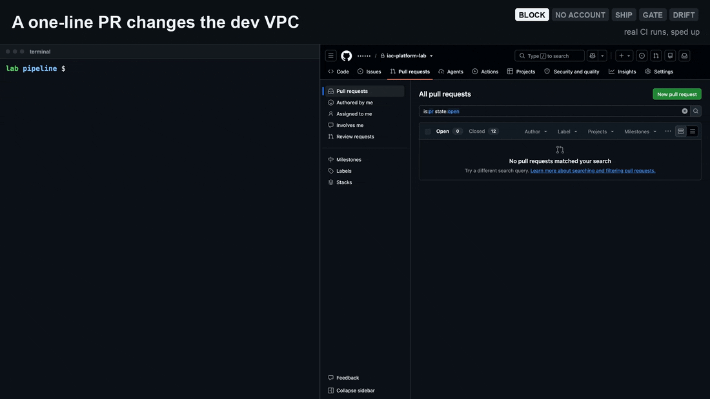
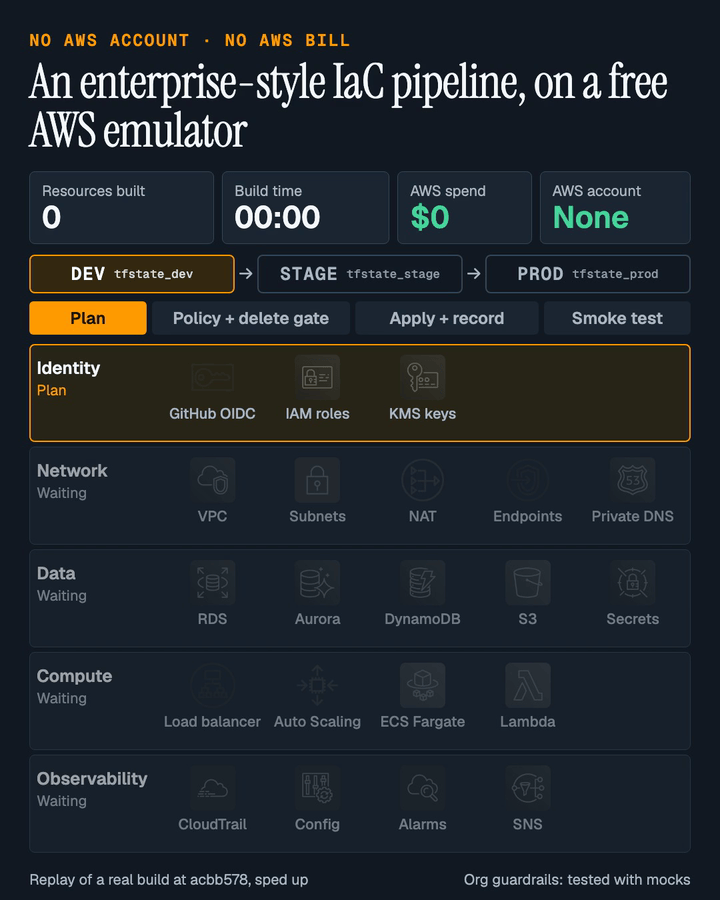
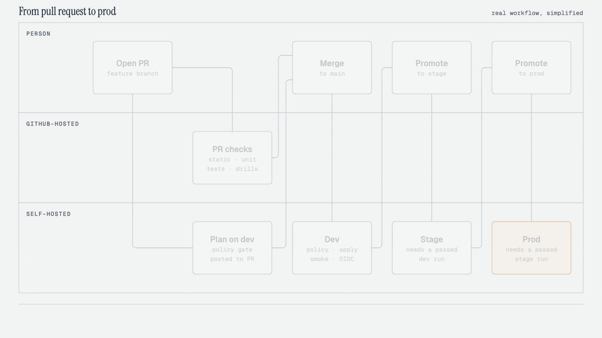

# Enterprise-style IaC pipeline with no AWS account

A Terraform and GitHub Actions delivery pipeline, tested end to end on the free [AWS Emulator](https://github.com/aws/aws-emulator). It builds three environments and 337 resources with $0 in AWS spend.

Terraform, GitHub Actions and the policy checks are real. The AWS APIs are emulated.

**[Watch the CI reel](videos/ci-reel-split-16x9.mp4)** (78 seconds, sped up) · [phone version](videos/ci-reel-feed-4x5.mp4) · [build replay](videos/build-replay.mp4) · [case study](docs/case-study.pdf) · [carousel](docs/carousel.pdf)

## What the reel shows

1. **A dangerous change is refused.** A one-line VPC change plans 24 resources to destroy. The policy gate stops it on 7 protected resources.
2. **No AWS account is involved.** Dev, stage and prod each run on their own local emulator.
3. **A safe change ships.** Log retention moves from 30 to 90 days, passes PR checks and reaches dev on merge.
4. **Promotion order is enforced.** A shortcut from dev to prod is refused, then stage and prod promote in order.
5. **Drift is caught.** A manual change in dev is named by resource and opens a GitHub issue.

## Measured results

| Measure | Result |
|---|---|
| Resources built | 337 (111 dev, 111 stage, 115 prod) |
| Build from empty | 15 min 14 s |
| Rebuild through GitHub Actions | 17 min 20 s for dev, stage and prod in order, on the latest emulator release (2026-11-25) |
| Re-plan after build | 15 of 15 stack deployments with no changes |
| Drift check | 15 of 15 stack deployments clean |
| State isolation | 3 databases and roles, 6 of 6 cross-environment logins refused |
| Delete gate | Prod VPC replacement refused on 7 protected resources |
| Backups | 3 state databases dumped and verified |
| AWS spend | $0 |

The build ran the pipeline's real promotion script on throwaway emulators and a throwaway Postgres, outside GitHub Actions. The time excludes one-time provider downloads and about 50 seconds of inventory capture.

## How the pipeline works

Every environment follows the same path: plan, policy gate, apply the exact saved plan, record state, smoke test. A daily drift check runs against dev, stage and prod.

## Central state for multiple teams

- **Isolation:** each environment has its own Postgres state database and non-admin role.
- **Protected deletes:** deleting or replacing a protected resource needs an approval naming the environment, stack and resource.
- **Recovery:** state databases get verified daily dumps, and a drill restores one into a new database.
- **Drift:** a daily job separates changes made outside Terraform from code that has not been promoted yet.

## Architecture and proof

| | |
|---|---|
| [Deployed architecture](images/architecture.png) | Drawn with TerraVision from a hand-checked graph of the deployed services |
| [Terraform graph](images/terraform-graph-network.png) | Real `terraform graph` output for the network module |
| [Policy refusal](images/policy-refusal.png) | The GitHub Actions log from the refused pull request |
| [Dev](images/env-dev.png), [stage](images/env-stage.png), [prod](images/env-prod.png) | Resources, drift status and state access for each environment |
| [Build explorer](explorer/index.html) | Interactive replay; download the `explorer` folder and open `index.html` |

## Limits

- IAM enforcement, SCP effect, a real OIDC login, cost, timing and quotas still need real AWS.
- One self-hosted runner holds all three state credentials, so promotion gates are a workflow control and not a credential boundary.
- The source repository has no branch protection, so a failed PR check does not prevent a merge. The same policy gate runs before every apply and stops it there.
- The videos are sped up. Account names are masked, and a repeated GitHub CLI tip was removed from the terminal.

## About this repository

This repository holds the demo material only. The lab source stays private.

I built the lab with Claude Code as my implementation partner. I made the architecture and version decisions and challenged the results, and Claude Code wrote most of the code.

Not affiliated with or endorsed by AWS, HashiCorp or GitHub.

## License

© 2026 Vibhu Bhatnagar. Licensed under [CC BY 4.0](LICENSE). Third-party names, logos and service icons belong to their owners and are not covered by this license.
